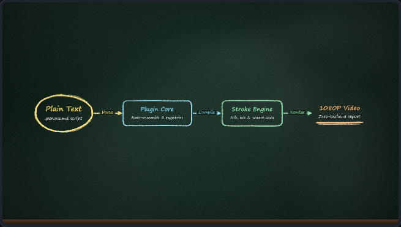
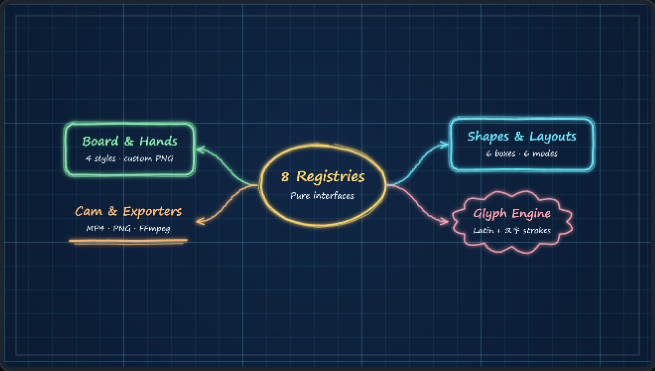
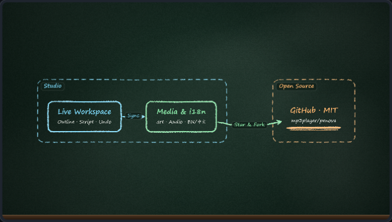

# Penova

**English** | [简体中文](README.zh-CN.md)

**Penova** (*Pen + Nova*) is a browser-native, plugin-extensible hand-drawn animation engine and visual studio built with React, TypeScript, Vite, and HTML5 Canvas.

It compiles structured diagrams, mind maps, concept graphs, and handwritten letters into stroke-by-stroke handwriting animations with intelligent camera direction, multi-scene transitions, auto-generated subtitles, audio tracks, and zero-backend 1080P exports.

---

## Showcase Gallery

All six scenes below ship inside the built-in **`Penova Product Intro (6 Scenes)`** template (defined declaratively in [docs/examples/penova-intro.penova.md](docs/examples/penova-intro.penova.md))—ready to preview in the Studio or export directly as `16:9` (`1920×1080`) and `9:16` (`1080×1920`) 1080P videos with one click.


| Chalkboard · Why Penova (Horizontal Flow) | Blueprint · Core Design Principles (Concept Graph) |
| :---: | :---: |
|  |  |
| **Blueprint · 8-Registry Plugin System (Mind Map)** | **Whiteboard · Script-Driven Custom Plugins (Vertical Flow)** |
|  |  |
| **Letter Paper · Real Penmanship (EN + 汉字)** | **Chalkboard · Full Studio & Open Source (Concept Graph)** |
|  |  |

---

## Highlights

- **Universal `SceneNode` Composite IR**: Abstracts `text`, `shape`, `connector`, and nestable `group` nodes uniformly to power flowcharts, mind maps, zoned concept graphs, long-form handwritten letters, and freeform boards.
- **8-Registry Plugin Architecture**:
  - **Shapes (`ShapePlugin`)**: `rounded`, `circle`, `cloud`, `underline`, `diamond`, `divider`.
  - **Layouts (`LayoutPlugin`)**: `flow-horizontal`, `flow-vertical`, `mindmap`, `concept-graph`, `document` (Letter / Doc), `freeform`, paired with two-way text codecs (`graphScriptCodec`, `documentScriptCodec`).
  - **Presentations (`PresentationPlugin`)**: `chalkboard`, `whiteboard`, `blueprint`, `letter-paper`.
  - **Glyph Stroke Providers (`GlyphProviderPlugin`)**: `stroke-order-dict` (Latin, numerals, and foundational CJK strokes, extensible via `registerStrokeOrderGlyphs`) + `ink-grid-fallback` (14×14 momentum ink-tracing for any arbitrary Unicode character).
  - **Hand Gestures (`HandPlugin`)**: `hand-chalk`, `hand-minimal`, `tip-only`, `hidden`, plus `createImageHandPlugin` to plug in real hand PNGs in 5 lines.
  - **Camera Directors (`CameraPlugin`)**: `auto-follow`, `progressive-fit`, `static-overview`, `pen-follow` (scrolling chase camera for long letters).
  - **Scene Transitions (`TransitionPlugin`)**: `chalkboard-eraser`, `page-turn`, `crossfade`, `cut`.
  - **Exporters (`ExportPlugin`)**: Zero-backend **1080P Video** (WebM/MP4 via `MediaRecorder`), **HD Poster PNG**, and **Offline FFmpeg Tar Bundle** (`.tar` with lossless PNG frames, `manifest.json`, and FFmpeg commands), plus `createHttpBridgeExportPlugin` for custom render servers.
- **Declarative `.penova.md` Text-to-Video Pipeline & Agent Skill**: Author multi-scene boards as pure Markdown/script text declaring `theme`, `layout`, `camera`, `hand`, and `transition` plugins (`parseProjectScript` / `serializeProjectScript`), inspect live grammar rules via `generateScriptSpec()`, or equip AI agents directly via the workspace skill at [.agents/skills/penova-animation/SKILL.md](.agents/skills/penova-animation/SKILL.md) (with [docs/examples/penova-intro.penova.md](docs/examples/penova-intro.penova.md)).
- **Built-in Bilingual Studio (`EN / 简体中文`)**: Ships with an instant `EN / 中文` switcher in the top bar and 6 bilingual showcase presets; third-party plugins automatically fall back to their own `name` without needing i18n keys.
- **Full Studio Workflow**: Multi-scene timeline, live single-scene & `.penova.md` script editor, auto subtitles with `.srt` import/export, voiceover/BGM track sync, procedural Web Audio writing sound effects, Undo/Redo history, `16:9` / `9:16` aspect ratios, `.penova.json` & `.penova.md` import/export, and localStorage auto-drafts.

---

## Layered Architecture

```text
src/components/, src/hooks/, src/i18n/   Studio UI, workspace/audio hooks & localization
                  │
                  ▼
           src/engine/                    Layout compiler, stroke animator, timeline, camera, audio & renderer
                  │
                  ▼
           src/plugins/                   8 independent plugin registries & built-in plugins
                  │
                  ▼
             src/sdk/                     Pure math, stroke path, brush & surface primitives
                  │
                  ▼
            src/model/                    Universal SceneNode IR, LessonProject, presets, history & storage
```

See the full plugin contract specification in [docs/PLUGIN_SPEC.md](docs/PLUGIN_SPEC.md) ([中文版](docs/PLUGIN_SPEC.zh-CN.md)).

---

## Quick Start

```bash
# Install dependencies
npm install

# Start Vite dev server
npm run dev

# Run unit tests
npm test

# Type-check & build production bundle
npm run build
```

---

## Minimal Plugin Extension Example

```ts
import { layoutRegistry, LayoutPlugin } from './src/plugins';
import { finalizeLayout, makePositionedNode } from './src/plugins/layouts/shared';

const customVerticalLayout: LayoutPlugin = {
  id: 'custom-vertical',
  name: 'Custom Vertical Doc',
  category: 'basic',
  icon: 'document',
  dragMode: 'offset',
  supportsEdges: false,
  compute(scene, helpers) {
    let y = 0;
    const nodes = scene.nodes.map((node) => {
      const measured = helpers.measureNode(node);
      const positioned = makePositionedNode(node, 0, y + measured.height / 2, measured, helpers);
      y += measured.height + 24;
      return positioned;
    });
    return finalizeLayout(nodes, []);
  },
};

layoutRegistry.register(customVerticalLayout);
```

---

## License

Released under the [MIT License](LICENSE).
