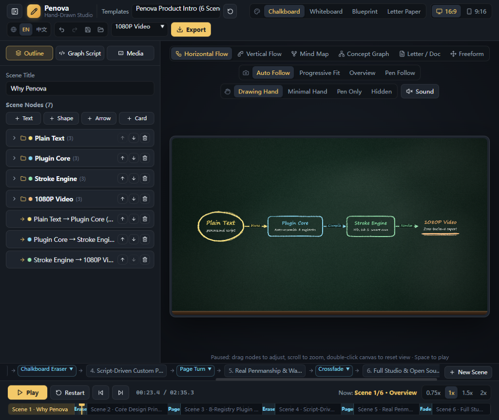
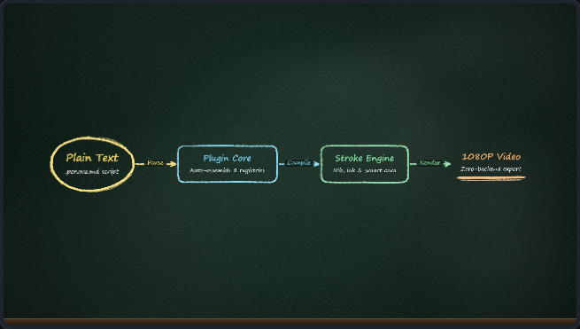
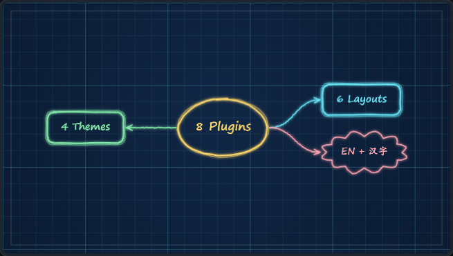
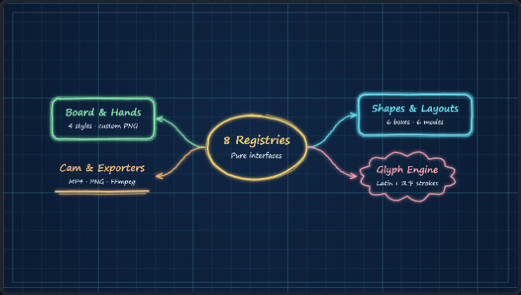
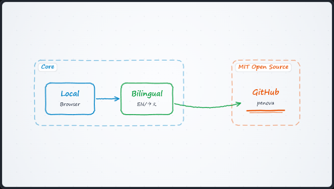
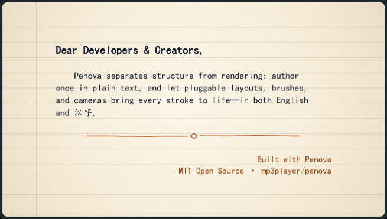
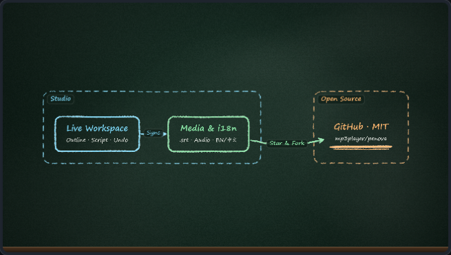

# Penova

[English](README.md) | **简体中文**

**Penova**（*Pen + Nova*）是一个运行在浏览器端的**可插件化手绘笔迹动画引擎与工作室**（React + TypeScript + Vite + HTML5 Canvas）：将结构化知识图谱、思维导图与手写书信文稿编译为逐字逐笔书写动画、智能运镜、多幕转场、字幕配音与 1080P 视频输出。

---

## 产品深度介绍六幕效果展示

以下 6 幕效果均已内置于教学模板 **`Penova 产品深度介绍（六幕）` / `Penova Product Intro (6 Scenes)`**（亦可由 [docs/examples/penova-intro.penova.md](docs/examples/penova-intro.penova.md) 一键脚本解析生成），可在工作室内预览并直接导出 `16:9`（`1920×1080`）与 `9:16`（`1080×1920`）1080P 视频。



| 黑板粉笔 · Why Penova（横向流程） | 蓝图线稿 · Core Design Principles（概念图谱） |
| :---: | :---: |
|  |  |
| **蓝图线稿 · 8-Registry Plugin System（思维导图）** | **白板马克笔 · Script-Driven Custom Plugins（纵向流程）** |
|  |  |
| **信纸钢笔 · Real Penmanship (EN + 汉字)** | **黑板粉笔 · Full Studio & Open Source（概念图谱）** |
|  |  |

---

## 核心特性

- **通用 `SceneNode` 组合节点树 IR**：统一抽象 `text`、`shape`、`connector`、`group` 与可扩展 `custom` 节点，支持流程图、思维导图、概念图谱、视觉微件、手写信纸文稿与自由画布等多种形态。
- **九大无头可插拔扩展注册表 (9-Registry Headless Plugin System)**：
  - **自定义视觉节点 (`SceneNodePlugin`)**：内置 `icon`、`sketch`、`code`、`chart` 四大视觉组件与卡片 `icon:` 属性；通过纯数据声明 `defineProps`（[src/sdk/propSchema.ts](src/sdk/propSchema.ts)）实现工作室双向绑定与 `--spec` 规范自动生成。
  - **外形插件 (`ShapePlugin`)**：`rounded`（圆角框）、`circle`（椭圆圈）、`cloud`（云朵框）、`underline`（双下划线）、`diamond`（菱形判断）、`divider`（手绘分割线）。
  - **布局插件 (`LayoutPlugin`)**：`flow-horizontal`（横向流程）、`flow-vertical`（纵向流程）、`mindmap`（思维导图）、`concept-graph`（概念图谱）、`document`（信纸文稿）、`freeform`（自由画布），在图谱布局中集成**避障连线路由** (`routeObstacleAwareConnector`)，并配套可逆文本编解码器 (`graphScriptCodec` / `documentScriptCodec`)。
  - **表现形式 (`PresentationPlugin`)**：`chalkboard`（黑板粉笔）、`whiteboard`（白板马克笔）、`blueprint`（蓝图线稿）、`letter-paper`（信纸钢笔）。
  - **字形笔画源 (`GlyphProviderPlugin`)**：`stroke-order-dict` 笔顺库（涵盖拉丁字母、数字与基础汉字，支持 `registerStrokeOrderGlyphs` 动态注入） + `ink-grid-fallback` 任意 Unicode 字符墨迹网格追踪兜底。
  - **执笔手势 (`HandPlugin`)**：`hand-chalk`（手握画笔）、`hand-minimal`（极简线稿手）、`tip-only`（仅笔杆）、`hidden`（隐藏），支持 `createImageHandPlugin` 快速接入实拍手图 PNG。
  - **运镜策略 (`CameraPlugin`)**：`auto-follow`（智能聚焦）、`progressive-fit`（渐进全景）、`static-overview`（固定全景）、`pen-follow`（跟写滚屏）。
  - **多幕转场 (`TransitionPlugin`)**：`chalkboard-eraser`（黑板擦擦除）、`page-turn`（翻页滑切）、`crossfade`（柔和淡化）、`cut`（直接硬切）。
  - **成品导出 (`ExportPlugin`)**：按 `category`（`'snapshot' | 'sequence'`）分组——零后端导出 **1080P 视频**（`mediarecorder-video`）、**高清 PNG 海报**（`poster-png`）、**离线 FFmpeg PNG 帧包**（`png-sequence-tar`），以及零 Canvas 依赖的矢量 **HD SVG**（`poster-svg`）与 **SVG 帧序列包 `.tar`**（`svg-sequence-tar`），并提供 `createHttpBridgeExportPlugin` 对接本地/云端合成服务。
- **SDK 扩展原语 (`src/sdk/`)**：提供递归可组合 DAG 内核（`workflowDag.ts`）、支持 20 个内置图标的 SVG/位图简笔画矢量化管线（`sketchPipeline.ts`）以及零依赖 `defineProps` 属性协议（`propSchema.ts`）。
- **声明式多幕脚本管道与 AI Agent Skill（`.penova.md` → 自动组装插件 → 视频）**：支持使用纯文本 `.penova.md` 声明各幕 `theme`、`layout`、`camera`、`hand` 与 `transition` 插件，通过 `generateScriptSpec()` 实时导出插件语法规范，并已内置 [.agents/skills/penova-animation/SKILL.md](.agents/skills/penova-animation/SKILL.md) 供 AI 直接规划分镜、生成脚本并无头导出动画产物（示例见 [docs/examples/penova-intro.penova.md](docs/examples/penova-intro.penova.md)）。
- **内置双语体验 (`EN / 简体中文`)**：界面默认英文，顶栏菜单一键切换 `EN / 中文`，且自带 6 套中英双语教学演示预设模板；第三方插件只需提供默认 `name`，无需感知多语言字典即可自动显示。
- **完整工作室能力与引擎/UI 严格解耦**：支持画布点击自动暂停并选中、双击节点行内快编、快捷键（`Delete`/`Backspace`、`Ctrl/Cmd+D`、`Esc`）、缩放与快捷操作浮窗、单幕循环开关、定格/视频统一导出菜单、带行号/错误高亮/快捷片段芯片的脚本编辑器、字幕（`.srt`）与配音同步、撤销/重做，以及仅在浏览器端生效的伴生 UI 扩展注册表 [src/studio/uiRegistry.ts](src/studio/uiRegistry.ts)。

---

## 分层架构

```text
src/components/, src/hooks/, src/i18n/   工作室 UI 壳层、工作区状态管理、音频同步与多语言层
                  │
                  ▼
           src/studio/                    浏览器端伴生 UI 注册表 (studioNodeUiRegistry)
                  │   (UI -> Engine 严格单向依赖；绝不打入无头导出包)
                  ▼
           src/engine/                    布局编译器、笔顺动画器、时间轴、运镜、音效与 Canvas/SVG 渲染器
                  │
                  ▼
           src/plugins/                   9 大独立无头插件注册表与全套内置插件实现
                  │
                  ▼
             src/sdk/                     纯数学、笔画路径、笔刷、简笔画管线、DAG 内核与 defineProps 协议
                  │
                  ▼
            src/model/                    通用 SceneNode IR、LessonProject、双语预设、历史栈与存储
```

更完整的插件契约定义与扩展示例请查阅：[docs/PLUGIN_SPEC.zh-CN.md](docs/PLUGIN_SPEC.zh-CN.md)（英文版：[docs/PLUGIN_SPEC.md](docs/PLUGIN_SPEC.md)）。

---

## 快速开始

```bash
# 安装依赖
npm install

# 启动本地开发服务器
npm run dev

# 运行单元测试
npm test

# TypeScript 类型检查 + 生产构建
npm run build
```

---

## 插件扩展极简示例

```ts
import { layoutRegistry, LayoutPlugin } from './src/plugins';
import { finalizeLayout, makePositionedNode } from './src/plugins/layouts/shared';

const customVerticalLayout: LayoutPlugin = {
  id: 'custom-vertical',
  name: 'Custom Vertical Doc',
  category: 'basic',
  icon: 'document',
  dragMode: 'offset',
  supportsEdges: false,
  compute(scene, helpers) {
    let y = 0;
    const nodes = scene.nodes.map((node) => {
      const measured = helpers.measureNode(node);
      const positioned = makePositionedNode(node, 0, y + measured.height / 2, measured, helpers);
      y += measured.height + 24;
      return positioned;
    });
    return finalizeLayout(nodes, []);
  },
};

layoutRegistry.register(customVerticalLayout);
```

---

## 开源协议

基于 [MIT License](LICENSE) 开源。
